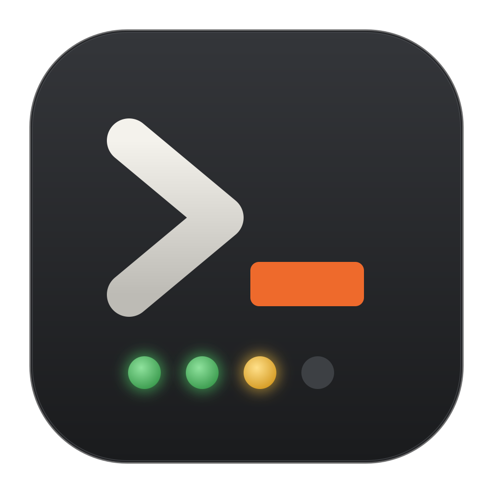
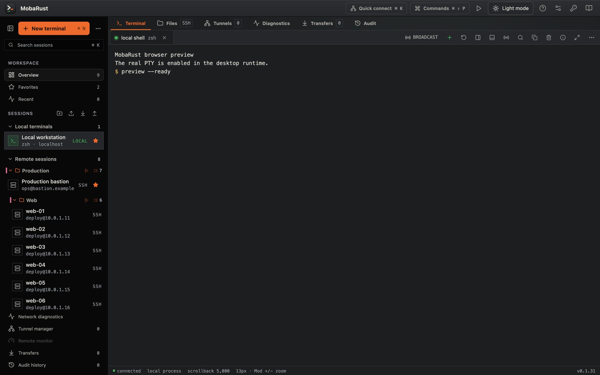
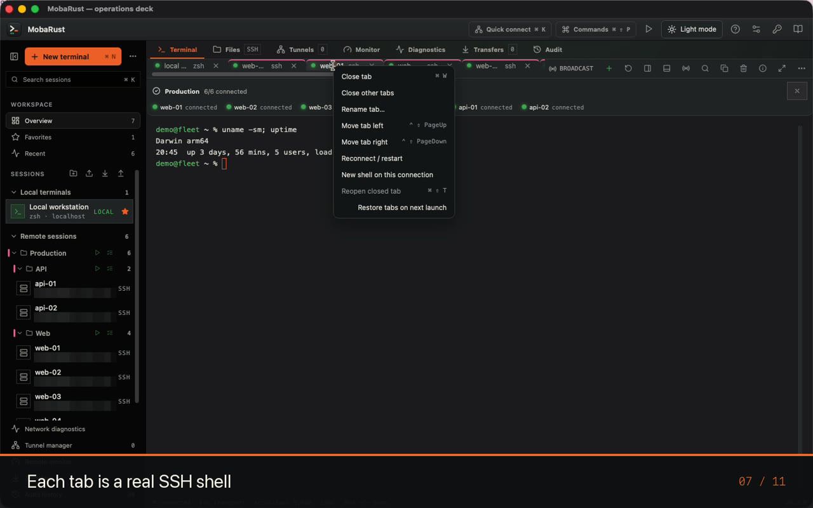
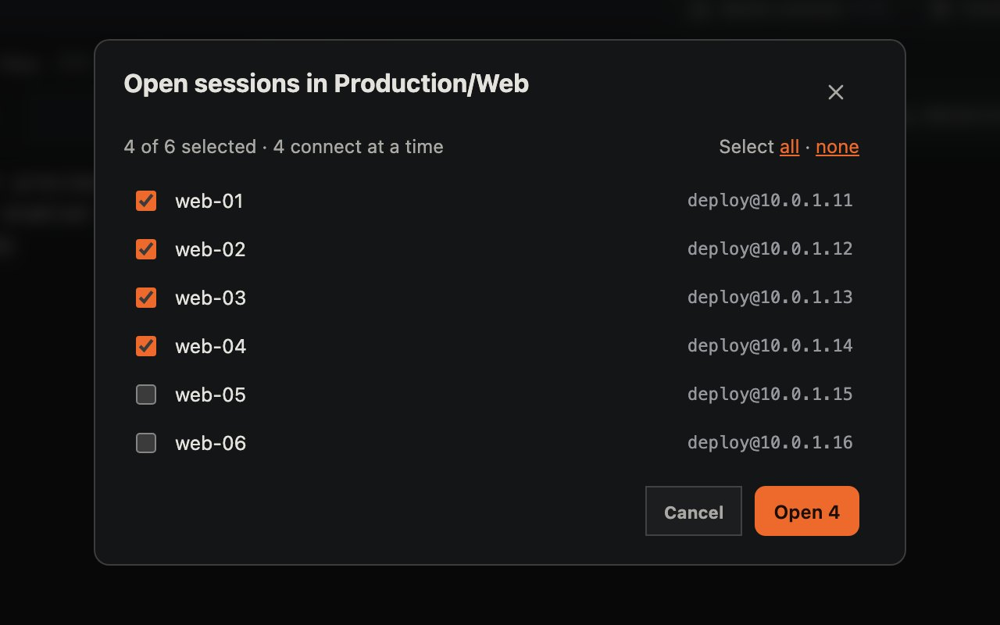
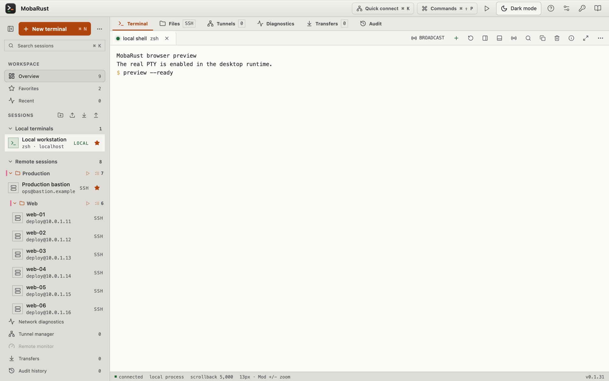

<div align="center">



# MobaRust

**An open-source, Rust-native MobaXterm alternative for macOS, Linux and Windows.**

Terminal tabs and splits · SSH with verified host keys · SFTP/SCP · tunnels · one-click server groups · MobaXterm import

[](https://github.com/OthmaneBlial/MobaRust/releases/tag/v0.2.0)
[](docs/architecture.md)
[](LICENSE)

[Download](#download) · [Website](https://othmaneblial.github.io/MobaRust/) · [Docs](https://othmaneblial.github.io/MobaRust/docs.html) · [Roadmap](ROADMAP.md) · [Contribute](CONTRIBUTING.md)

</div>



<sub>Screenshots show 0.2.0 in browser-preview mode (the real React UI without the native runtime).</sub>

### See it run

[](https://othmaneblial.github.io/MobaRust/#demo)

<sub>Click to watch the 40-second demo on the website: captioned screenshots of the native 0.2.0 Mac app, taken during testing against a local OpenSSH server.</sub>

## Why MobaRust

If you left Windows and MobaXterm behind, you lost a tool that keeps hundreds of servers one click away. MobaRust brings that workflow to macOS first, then Linux and Windows. It is open source and has no cloud account. Secrets stay in your operating system's vault.

- **The terminal gets the window.** The sidebar can be resized or collapsed (`⇧⌘B`). Focus mode (`⇧⌘↵`) hides everything but the terminal. Tabs and splits resize the PTY correctly.
- **Open a whole group at once.** Nested folders open with one click, or tick just the hosts you need. Connections open four at a time, with a status light per host, and you can cancel or retry the failures.
- **Bring your MobaXterm sessions.** The importer reads `.mxtsessions`, `.moba` and `MobaXterm.ini` files exported on Windows, on any operating system. It shows a preview and lets you choose merge, replace or skip for each duplicate. It never imports passwords.
- **Safety stays visible but quiet.** Host keys are always verified. Saved sessions hold only references to your credentials. Broadcast input and macros need explicit targets.

<table>
<tr>
<td width="50%" valign="top">

### Open selected servers



</td>
<td width="50%" valign="top">

### Dark and light



</td>
</tr>
</table>

### Open a group from the command line

```bash
mobarust --open-group "Production/Web"
```

The name can be a full path, a case-insensitive match, or a unique leaf folder name. When a name is ambiguous, MobaRust lists the matches instead of guessing.

## What works today

| Area | Status |
| --- | --- |
| Local shells, tabs, splits, search, font zoom | Working |
| SSH: keys, agent, password, keyboard-interactive, jump hosts, reconnect | Working; tested against a real local OpenSSH server |
| SFTP/SCP transfers, remote text editing | Working; tested against a real local OpenSSH server |
| Local, remote and SOCKS5 tunnels | Working; traffic tested through real OpenSSH |
| One-click groups (open all, open selected, `--open-group`) | Working; 14 concurrent sessions tested on loopback |
| MobaXterm import | Working for SSH and SFTP bookmarks: folders, host, port, user, login command, SSH gateways, key file names. Windows exports open on any OS. Tested end to end against real local OpenSSH with synthetic exports. RDP, VNC, Telnet and serial bookmarks are listed, not imported |
| Telnet, serial | Working; unencrypted transports are labelled |
| VNC, RDP | **Experimental**; RDP is not in normal installers |

The evidence for every row, and its gaps, is in [`docs/TEST_MATRIX.md`](docs/TEST_MATRIX.md). Run all localhost protocol suites with `./tools/local-protocol-lab.sh`.

<a id="download"></a>

## Download

| Platform | Download | Version |
| --- | --- | --- |
| macOS · Apple Silicon | [ARM64 DMG](https://github.com/OthmaneBlial/MobaRust/releases/download/v0.2.0/MobaRust-0.2.0-macos-arm64.dmg) | 0.2.0 |
| macOS · Intel | [x64 DMG](https://github.com/OthmaneBlial/MobaRust/releases/download/v0.2.0/MobaRust-0.2.0-macos-x64.dmg) | 0.2.0 |
| Windows · x64 | [Installer](https://github.com/OthmaneBlial/MobaRust/releases/download/v0.2.0/MobaRust-0.2.0-windows-x64.exe) | 0.2.0 |
| Ubuntu / Debian · x64 | [DEB](https://github.com/OthmaneBlial/MobaRust/releases/download/v0.2.0/MobaRust-0.2.0-linux-x64.deb) | 0.2.0 |
| Other Linux · x64 | [AppImage](https://github.com/OthmaneBlial/MobaRust/releases/download/v0.2.0/MobaRust-0.2.0-linux-x64.AppImage) | 0.2.0 |

These are **preview builds**: macOS builds are ad hoc signed and not notarized, and no build has a publisher signature. [Release notes and SHA-256 files](https://github.com/OthmaneBlial/MobaRust/releases/tag/v0.2.0) · [Installation help](docs/release/preview-notes.md)

## Build from source

You need Rust stable **1.90+**, Node.js **22**, pnpm **10**, and the [Tauri prerequisites](CONTRIBUTING.md).

```bash
git clone https://github.com/OthmaneBlial/MobaRust.git
cd MobaRust
pnpm install --dir apps/desktop --frozen-lockfile
cargo xtask check
pnpm --dir apps/desktop tauri dev
```

```bash
./tools/local-protocol-lab.sh   # real SSH/SFTP/tunnel/Telnet/serial suites on loopback, with a cleanup check
```

The local tests use only loopback, disposable keys and temporary directories. They never touch your SSH config, Remote Login or firewall. [Safe testing](docs/security/safe-testing.md)

## Learn more

[Migrating from MobaXterm](docs/migration-from-mobaxterm.md) · [Keyboard shortcuts](docs/keyboard-shortcuts.md) · [Architecture](docs/architecture.md) · [Design system](DESIGN.md) · [Threat model](docs/security/threat-model.md) · [Security policy](SECURITY.md)

<div align="center">

[Report a bug](https://github.com/OthmaneBlial/MobaRust/issues/new/choose) · [Star MobaRust](https://github.com/OthmaneBlial/MobaRust/stargazers)

Independent project, not affiliated with Mobatek or MobaXterm. Licensed under [Apache-2.0](LICENSE).

</div>
